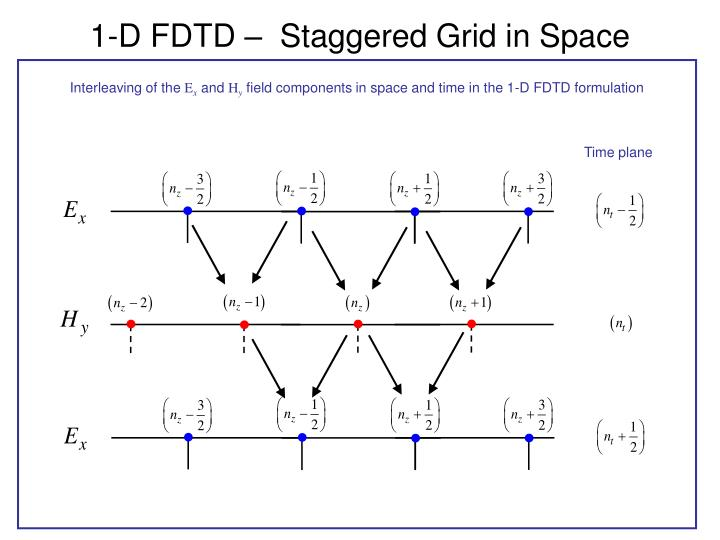

## 5.1 Spatial Staggering

In the Yee scheme, the electric field $E_x$ and the magnetic field $H_y$ are spatially staggered by half a grid cell. Therefore, we define the fields as:

$$
\begin{align*}
&E^n_x(i) &&\text{with position } z_i = i\Delta z \\[1.5em]
&H^{n+\frac{1}{2}}_y \, \bigg(i + \frac{1}{2}\bigg) &&\text{with position } z_{i+\frac{1}{2}} = \bigg(i + \frac{1}{2}\bigg)\Delta z
\end{align*}
$$

## 5.2 Temporal Staggering

The same staggering principle is applied in time, determining the instants at which the electric and magnetic fields are evaluated:

$$
\begin{align*}
&E^n_x(i) &&\text{at instant } t_n = n\Delta t \\[1.5em]
&H^{n+\frac{1}{2}}_y \, \bigg(i + \frac{1}{2}\bigg) &&\text{at instant } t_{n+\frac{1}{2}} = \bigg(n + \frac{1}{2}\bigg)\Delta t
\end{align*}
$$

## 5.3 Yee Lattice Representation

The spatial and temporal staggering of the electric and magnetic fields allows the use of centered finite-difference approximations to calculate the spatial and temporal derivatives in Maxwell's equations.

The following figure illustrates the spatial and temporal staggering of the electric and magnetic fields described above.

*Figure 1 — One-dimensional Yee lattice showing the spatial and temporal staggering of the electric and magnetic fields.*